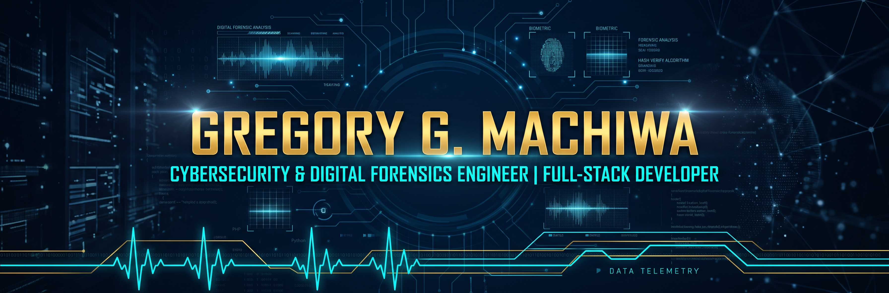

<!-- ==================== ANIMATED CYBER HEADER ==================== -->

  

<!-- ==================== LIVE TERMINAL TYPING ==================== -->

  

<!-- ==================== ACTION & SOCIAL PILLS ==================== -->

  
  
  
  

  

